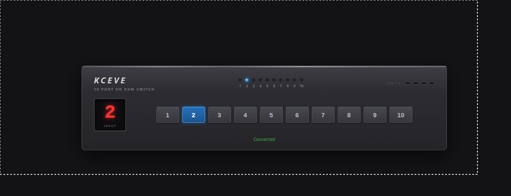

[](https://github.com/vroomfondel/dgxarley/actions/workflows/mypynpytests.yml)
[](https://github.com/vroomfondel/dgxarley/actions/workflows/checkblack.yml)
[](https://github.com/vroomfondel/dgxarley)


# dgxarley

Tooling for the DGX Arley K3s inference cluster — integration tests, streaming utilities, and CLI entry points for SGLang, Ollama, and OpenWebUI services.


**Heureka! — Qwen3-235B-A22B MoE (AWQ 4-bit) running distributed inference across both DGX Sparks:**


### `sglang-raw` — Dual-panel SSE stream viewer


Dual-panel Rich TUI for inspecting SGLang's OpenAI-compatible streaming API in real time. The top half renders the AI response as it arrives, while the bottom half displays the raw JSON SSE stream chunks — showing fields like `chat_completion_chunk`, `choices`, `delta`, `finish_reason`, and `model`. Useful for debugging streaming behaviour, verifying token delivery, and understanding the wire format of the API.

### `sglang-raw` — Think/text token classification


Token-level stream inspection with per-chunk breakdown in a structured table. Columns show the token type (`think` vs `text`), content, finish reason, and cumulative token count — visualizing how reasoning tokens (from `<think>...</think>` blocks) are separated from the actual output tokens. This view helps when tuning thinking budgets, verifying `reasoning_parser` behaviour, or diagnosing unexpected token classification.

## What's included

### CLI tools

| Command               | Description                                                                                                                                        |
|-----------------------|----------------------------------------------------------------------------------------------------------------------------------------------------|
| `sglang-raw`          | Interactive SSE stream viewer with dual-panel Rich display (interpreted output + raw JSON chunks)                                                  |
| `sglang-test`         | Direct SGLang client with sequential and parallel load testing (live Rich TUI)                                                                     |
| `sglang-bench`        | Benchmark launcher for SGLang with persistent dataset caching and concurrency-sweep mode                                                           |
| `sglang-gsm8k`        | GSM8K accuracy/throughput harness for reasoning models via the chat API (`fetch` / `run` / `analyze`), truncation counted separately               |
| `openwebui-test`      | OpenWebUI / LLM client with preset management and streaming                                                                                        |
| `ollama-test`         | Ollama API health, model, embedding, and chat completions tests                                                                                    |
| `comfyui-test`        | ComfyUI integration tests for the local image-generation playground                                                                                |
| `kceve-kvm`           | RS232 serial control for KCEVE KVM1001A KVM switches — 4-port and 10-port variants, `--ports`/`KCEVE_KVM_PORTS` (switch ports, query state, sniff) |
| `kceve-kvm-web`       | Web UI for KCEVE KVM control (FastAPI, requires `dgxarley[web]`)                                                                                   |
| `kceve-kvm-web-plain` | Lightweight web UI for KCEVE KVM control (stdlib `http.server`, no extra dependencies)                                                             |
| `keel-drift`          | Finds Keel-tracked K8s workloads whose running image lags behind its tag (requires `dgxarley[k3s]`)                                                |
| `k3s-keys-sync`       | Syncs the local `~/.kube/config` with the kubeconfig of a remote K3s server                                                                        |

### `keel-drift` — Keel drift check

On every poll, [Keel](https://keel.sh) compares the registry digest of right now against the digest it memorised during the previous poll. That memo lives in memory only and is seeded from the registry at startup, so what actually runs in the cluster never enters Keel's decision: if a tag is moved while Keel restarts, Keel sets its baseline to the new digest without ever touching the Deployment, and the change stays invisible until the next push.

`keel-drift` performs exactly the comparison Keel does not — the digest of the running pod against the digest the tag currently points at — across every Deployment, StatefulSet and DaemonSet carrying an active `keel.sh/policy`, containers and initContainers alike. Since initContainer tracking is opt-in in Keel (`keel.sh/initContainers: "true"`), a stale one that Keel would never touch is called out explicitly. It resolves multi-arch tags on both the index and the per-platform level, authenticates with the workload's `imagePullSecrets` (falling back to the local Docker login so Docker Hub does not count against the anonymous 100/h per-IP limit), and flags containers where `imagePullPolicy != Always`, since a restart cannot renew an unchanged tag there. It also separates index drift from image drift: a running digest that is an older index over the *same* platform manifests counts as current, so a re-pushed index shell is not misreported as a stale image.

```bash
pip install 'dgxarley[k3s]'

keel-drift                          # every tracked workload
keel-drift --context ht@dgxarley    # a specific kubeconfig context
keel-drift --namespace somestuff    # a single namespace
keel-drift --drift-only --quiet     # drift only, terse
keel-drift --fix-command            # print rollout-restart commands
```

The table goes to stdout and progress to stderr, so the output stays pipe-friendly. It checks the current kubeconfig context unless `--context` (or `KUBE_CONTEXT`) names another one; with an explicit context there is no in-cluster fallback, and the printed fix commands carry the same `--context`. The exit code is `1` as soon as at least one workload is stale (`2` if the context could not be loaded), which makes it usable as a pipeline gate.

### `kceve-kvm-web` — KCEVE KVM1001A Web UI



Browser-based control panel for the KCEVE KVM1001A KVM switch via RS232 serial. Shows the currently active input port on a virtual 7-segment display and allows switching between inputs with a single click. The port count defaults to 10 and is selectable for the 4-port variant via `-n/--ports` (or the `KCEVE_KVM_PORTS` env var). Commands are sent over a USB-to-RS232 adapter at 115200 baud using the `X<channel>,1$` ASCII protocol.

With `-c/--console-url` (or the `KCEVE_KVM_CONSOLE_URL` env var) `/` turns into a console view: a compact port bar on top and the remote console (e.g. a GL.iNet Comet KVM behind the switch) embedded below it, so switching and watching happen in one window. The replica stays available at `/panel`. The console must allow being framed by the kceve page and should share its site (same registrable domain), otherwise browsers drop its login cookies inside the frame.

[Demo video](https://raw.githubusercontent.com/vroomfondel/dgxarley/main/media/simplescreenrecorder-2026-04-04_17.10.24.mp4)

<details>
<summary>Remote test setup (serial over SSH tunnel)</summary>

If the KVM is connected to a remote host, you can tunnel the serial port via TCP:

```bash
# 1. On k3smaster (where the USB-RS232 adapter is connected): expose serial as TCP server
root@k3smaster ~ # socat tcp-listen:7000,reuseaddr,fork /dev/ttyACM0,b115200,raw,echo=0

# 2. On workstation: SSH tunnel to remote TCP port
user@workstation ~ $ ssh -N -L 7000:127.0.0.1:7000 root@k3smaster &

# 3. On workstation: create local PTY from TCP tunnel
user@workstation ~ $ socat pty,link=/tmp/kvm-serial,raw,echo=0 tcp:127.0.0.1:7000 &

# 4. On workstation: start web UI on the local PTY
user@workstation ~ $ kceve-kvm-web -d /tmp/kvm-serial -p 8080
```

Then open `http://localhost:8080` in a browser.
</details>

### Libraries

| Module                                            | Description                                                                      |
|---------------------------------------------------|----------------------------------------------------------------------------------|
| `dgxarley.integration.repetition_detector`        | Offline n-gram, sentence, and loop repetition analysis for completed LLM outputs |
| `dgxarley.integration.streaming_repetition_guard` | Real-time repetition detection for token streams with configurable thresholds    |

## Installation

```bash
pip install dgxarley
```

Some CLIs need optional dependencies:

| Extra          | Installs                                      | Needed for      |
|----------------|-----------------------------------------------|-----------------|
| `k3s`          | `kubernetes`, `typer`                         | `keel-drift`    |
| `web`          | `fastapi`, `uvicorn[standard]`                | `kceve-kvm-web` |
| `sglang-bench` | `sglang`, `transformers`, `pybase64`, `typer` | `sglang-bench`  |

```bash
pip install 'dgxarley[k3s]'
```

Everything else — `sglang-raw`, `sglang-gsm8k`, `sglang-test`, `openwebui-test`, `ollama-test`, `comfyui-test`, `kceve-kvm`, `kceve-kvm-web-plain`, `k3s-keys-sync` and both libraries — runs on the base install.

## Quick start

```python
from dgxarley.integration.repetition_detector import detect_repetition

report = detect_repetition(llm_output)
print(report.summary())
# [LOW] score=0.12 — N-Gram 'this is a test' x2
```

```python
from dgxarley.integration.streaming_repetition_guard import RepetitionGuard

guard = RepetitionGuard()
for chunk in llm_stream:
    token = chunk.choices[0].delta.content or ""
    result = guard.feed(token)
    if result.should_stop:
        print(f"STOP: {result.reason}")
        break
```

## Requirements

- Python >= 3.14

## Source & documentation

Full documentation, network architecture, and Ansible playbooks: [GitHub](https://github.com/vroomfondel/dgxarley)

## License
This project is licensed under the LGPL where applicable/possible — see [LICENSE.md](https://github.com/vroomfondel/dgxarley/blob/main/LICENSE.md). Some files/parts may use other licenses: [MIT](https://github.com/vroomfondel/dgxarley/blob/main/LICENSEMIT.md) | [GPL](https://github.com/vroomfondel/dgxarley/blob/main/LICENSEGPL.md) | [LGPL](https://github.com/vroomfondel/dgxarley/blob/main/LICENSELGPL.md). Always check per‑file headers/comments.


## Authors
- Repo owner (primary author)
- Additional attributions are noted inline in code comments


## Acknowledgments
- Inspirations and snippets are referenced in code comments where appropriate.


## ⚠️ Note

This is a development/experimental project. For production use, review security settings, customize configurations, and test thoroughly in your environment. Provided "as is" without warranty of any kind, express or implied, including but not limited to the warranties of merchantability, fitness for a particular purpose and noninfringement. In no event shall the authors or copyright holders be liable for any claim, damages or other liability, whether in an action of contract, tort or otherwise, arising from, out of or in connection with the software or the use or other dealings in the software. Use at your own risk.


